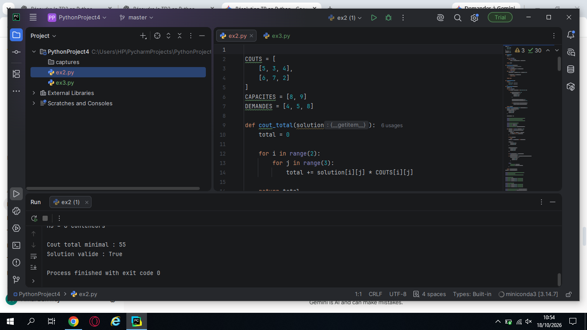
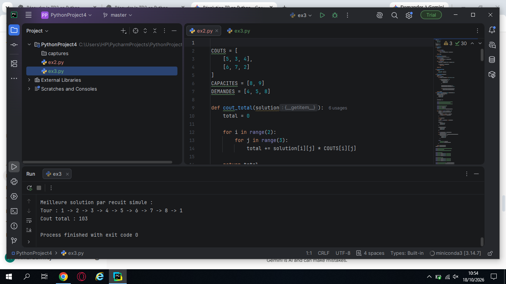
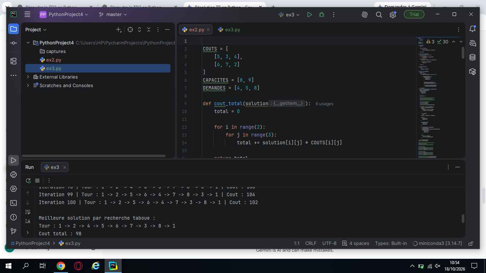

# Rendu TD N°2 - Recherche Opérationnelle

**Étudiante :** Amal Ben Fraj  
**Filière :** Licence en Sciences de l'Informatique - Faculté des Sciences de Sfax  

## Contenu du projet
Ce dépôt GitHub contient la résolution en Python des exercices du Travaux Dirigés N°2 :

* **Exercice 2 (`ex2.py` / `main.py`) :** Problème de transport résolu par la méthode de **Recherche Taboue**.
* **Exercice 3 (`ex3.py`) :** Problème du Voyageur de Commerce (TSP) résolu par :
  * La **Recherche Taboue** (solution initiale : `1-2-3-4-5-6-7-8-1`).
  * Le **Recuit Simulé** (sur 5 itérations avec variation empirique de la température).

---

## Résultats des Exécutions

### Exercice 2 : Recherche Taboue (Transport)

### Exercice 3 : Recherche Taboue (TSP)

### Exercice 3 : Recuit Simulé (TSP)

