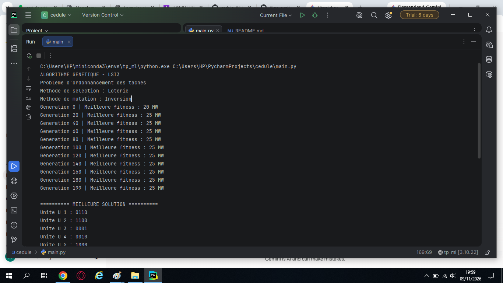
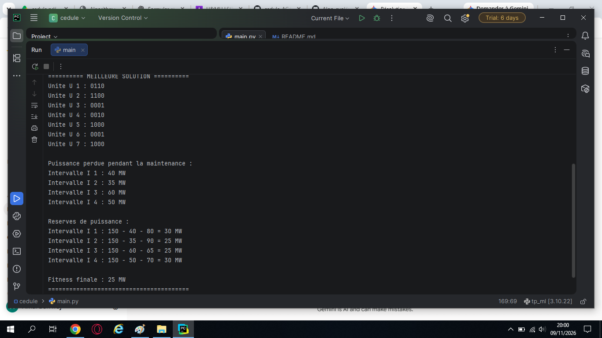

# TP : Problème d'ordonnancement des tâches par Algorithme Génétique

## 1. Présentation du TP

**Matière :** Algorithme Génétique  
**Niveau :** LSI3  
**Langage de programmation :** Python  
**Environnement de développement :** PyCharm  

L'objectif de ce TP est de résoudre un problème d'ordonnancement des tâches à l'aide d'un algorithme génétique (AG).

Le problème consiste à déterminer un calendrier de maintenance pour sept centrales électriques réparties sur quatre intervalles de temps, afin de maximiser la réserve minimale de puissance électrique.

## 2. Données du problème

Le problème comporte sept centrales électriques :

| Centrale | Capacité (MW) | Durée de maintenance |
|---|---:|---:|
| U1 | 20 | 2 intervalles |
| U2 | 15 | 2 intervalles |
| U3 | 35 | 1 intervalle |
| U4 | 40 | 1 intervalle |
| U5 | 15 | 1 intervalle |
| U6 | 15 | 1 intervalle |
| U7 | 10 | 1 intervalle |

La capacité totale est de 150 MW.

Les demandes électriques sont :
- I1 : 80 MW
- I2 : 90 MW
- I3 : 65 MW
- I4 : 70 MW

## 3. Formulation mathématique

### 3.1. Variables de décision

On définit une variable binaire :

- x(i,j) = 1 si la centrale i est en maintenance pendant l'intervalle j.
- x(i,j) = 0 sinon.

### 3.2. Fonction objective

L'objectif est de maximiser la réserve minimale de puissance :

**Max Z = min(R1, R2, R3, R4)**

Avec :

Rj = Capacité totale - Puissance en maintenance - Demande.

### 3.3. Contraintes

- Chaque centrale doit respecter son nombre d'intervalles de maintenance.
- Les calendriers doivent respecter les configurations autorisées.
- Les variables de décision sont binaires.
- La réserve de puissance doit être strictement positive pour chaque intervalle.

## 4. Méthodes utilisées dans l'algorithme génétique

- **Représentation :** chromosome composé de sept gènes de quatre bits.
- **Population initiale :** 50 individus.
- **Fonction Fitness :** calcul de la réserve minimale.
- **Sélection :** méthode par loterie (Roulette Wheel Selection).
- **Croisement :** croisement à un point.
- **Mutation principale :** mutation par inversion.
- **Mutation alternative :** mutation par remplacement.
- **Élitisme :** conservation des deux meilleurs individus.
- **Nombre de générations :** 200.

## 5. Implémentation Python

Le programme est développé dans le fichier `ordonnancement_AG.py`.

Les principales fonctions utilisées sont :

- `creer_chromosome()` : création d'un chromosome valide.
- `evaluer()` : calcul de la fitness.
- `selection_loterie()` : sélection par loterie.
- `croisement()` : croisement des parents.
- `mutation_inversion()` : mutation par inversion.
- `mutation_remplacement()` : mutation alternative par remplacement.
- `algorithme_genetique()` : exécution de l'algorithme génétique.

## 6. Captures d'écran

### 6.1. Structure du projet

Cette capture présente l'organisation du projet dans PyCharm, avec le fichier Python, le README et le dossier des captures.

### 6.2. Exécution du programme

Cette capture présente l'exécution de l'algorithme génétique dans PyCharm, l'évolution des générations et la meilleure solution obtenue avec les réserves de puissance calculées.

## 7. Résultats obtenus

Une meilleure solution possible permet d'obtenir les réserves suivantes :

| Intervalle | Réserve |
|---|---:|
| I1 | 30 MW |
| I2 | 25 MW |
| I3 | 25 MW |
| I4 | 30 MW |

La fitness finale est :

**Fitness = min(30, 25, 25, 30) = 25 MW.**

Cette valeur représente la réserve minimale de puissance garantie par le calendrier de maintenance.

## 8. Conclusion

Ce TP nous a permis d'appliquer les principales étapes d'un algorithme génétique pour résoudre un problème d'ordonnancement.

Nous avons utilisé la représentation par chromosomes, la sélection par loterie, le croisement à un point et la mutation par inversion.

L'algorithme génétique permet de rechercher un calendrier de maintenance qui maximise la réserve minimale de puissance électrique tout en respectant les contraintes du problème.